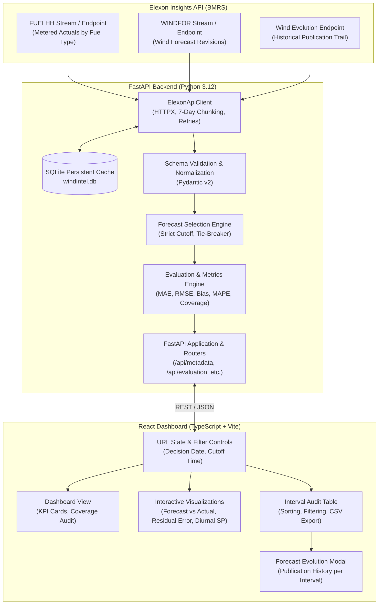

# WindIntel — UK Wind Forecast Intelligence Platform

[](https://www.python.org/)
[](https://fastapi.tiangolo.com/)
[](https://react.dev/)
[](https://www.typescriptlang.org/)
[](https://vitejs.dev/)
[]()

> Decision-support platform for UK electricity utilities to evaluate day-ahead wind power generation forecasts against metered outturn data, reconstruct historical purchasing constraints, detect systematic model biases, and manage imbalance risk.

---

## 1. Business Problem & Market Context

In the Great Britain wholesale electricity market, utilities must purchase electricity day-ahead to meet forecast customer demand. While wind energy provides low marginal-cost power, its availability is dependent on atmospheric conditions and inherently uncertain.

Day-ahead trading teams submit binding physical orders into power exchanges (EPEX SPOT / Nord Pool) at a strict mid-day gate closure (typically 11:00 or 12:00 local time).
* **The Overforecasting Danger:** If a utility assumes 10,000 MW of wind will arrive tomorrow and outturn is only 8,000 MW, the utility is left short in real-time and faces punitive System Buy Price (SBP) imbalance cashout penalties.
* **The Underforecasting Danger:** If models underestimate wind, the utility needlessly buys expensive gas/thermal peaker contracts at peak rates.

**WindIntel solves this operational problem by answering:**
1. *What was the latest, most accurate wind forecast actually available when purchasing decisions were made?*
2. *How did that forecast compare against metered outturn after delivery?*
3. *Where are our systematic forecast errors across dates, settlement periods, and lead times?*

---

## 2. System Architecture

WindIntel is structured as a decoupled monorepo separating data ingestion and statistical domain logic from presentation.



---

## 3. Official Elexon Data Sources & Upstream Contracts

WindIntel integrates directly with the official Elexon Insights Solution (formerly BMRS) REST API:
* **Base URL:** `https://data.elexon.co.uk/bmrs/api/v1`
* **Authentication:** Open, public data; no API key required.

### 3.1 Actual Wind Generation (`FUELHH`)
* **Endpoint:** `GET /datasets/FUELHH` (filtered by `fuelType=WIND`)
* **Resolution:** Half-hourly (48 settlement periods/day in Great Britain; 46/50 on daylight saving clock change days).
* **Unit:** **Megawatts (MW)** instantaneous average power per 30-minute interval.

### 3.2 Wind Generation Forecasts (`WINDFOR`)
* **Endpoint:** `GET /datasets/WINDFOR`
* **Resolution:** Hourly projections (settlement periods 1, 3, 5, ..., 47).
* **Timestamps Preserved:**
  * `startTime`: The target delivery interval being forecast.
  * `publishTime`: When NESO generated and published that specific forecast revision.

### 3.3 Historical Evolution Feed
* **Endpoint:** `GET /forecast/generation/wind/evolution?startTime={delivery_startTime}`
* Used to inspect the full chronological sequence of revisions published for any specific delivery interval. Both the evaluation table and the evolution modal share the exact same selection engine to ensure 100% agreement on the chosen forecast version.

### 3.4 Upstream API Constraints & 7-Day Chunking
The Elexon API strictly returns `HTTP 400 Bad Request` if any query date range exceeds 7 days.
WindIntel implements an automated chunking algorithm that splits requests into chunks of at most 4–5 days, shielding users from range errors while storing immutable historical data in an embedded SQLite database (`windintel.db`).

---

## 4. Forecast Selection Methodology

To reconstruct the exact information state available to traders at gate closure without lookahead bias:

1. **Filtering by Cutoff (Anti-Leakage Guarantee):**
   $$\text{Eligible Revisions} = \{ r \in \text{Forecasts}(t_{\text{delivery}}) \mid \text{publish\_time}(r) \le t_{\text{cutoff}} \}$$
   Any forecast published even 1 second after the cutoff timestamp is strictly disqualified.
2. **Latest Available Version:**
   The algorithm selects $\max(\text{publish\_time})$ among all eligible revisions.
3. **Deterministic Tie-Breaking:**
   If multiple revisions share the exact same publication timestamp, ties are broken deterministically by generation value and insertion order.
4. **Independence from Actuals:**
   Metered actual generation values never influence forecast selection.

---

## 5. Statistical Evaluation Metrics & Missing-Data Handling

Accuracy metrics are calculated **strictly on valid matched forecast-actual pairs**:

* **Mean Absolute Error (MAE):**
  $$\text{MAE} = \frac{1}{N} \sum_{i=1}^N |F_i - A_i|$$
* **Root Mean Squared Error (RMSE):**
  $$\text{RMSE} = \sqrt{\frac{1}{N} \sum_{i=1}^N (F_i - A_i)^2}$$
* **Mean Signed Error / Bias:**
  $$\text{Bias} = \frac{1}{N} \sum_{i=1}^N (F_i - A_i)$$
  *(Positive values indicate systematic overforecasting; negative indicate underforecasting)*
* **Mean Absolute Percentage Error (MAPE):**
  $$\text{MAPE} = \frac{1}{M} \sum_{i \in \text{Valid}} \left| \frac{F_i - A_i}{A_i} \right| \times 100\%$$
  * **Threshold Exclusion:** To prevent percentage distortion during near-calm atmospheric conditions, intervals with actual generation at or below the documented threshold ($A_i \le 100\text{ MW}$) are excluded from MAPE, with the excluded count explicitly reported in the audit metrics.

### 5.1 Strict Missing Data & Clamping Rules
* **No Artificial Zeros:** Missing generation values are preserved as `None` / `MISSING` and are **never** silently converted to zero (`0.0`).
* **Preservation of Genuine Zeros:** True zero generation is preserved and distinguished from missing data.
* **No Clamping:** Negative values or sensor anomalies are preserved rather than clamped to zero.
* **Resolution Asymmetry:** Hourly WINDFOR forecasts paired with half-hourly FUELHH metered outturns yield ~24 matched pairs out of 48 expected intervals (50% coverage). Unpaired intervals are strictly excluded from accuracy metrics with explicit coverage accounting.

---

## 6. Date & Timezone Standards

* **Market Timezone:** `Europe/London` (Greenwich Mean Time / British Summer Time).
* **Delivery Calendar:** Day-ahead delivery begins at `00:00:00` local time and ends at `24:00:00` local time.
* **Daylight Saving Transitions:** Dynamic settlement period generation correctly handles standard 48-interval days (24h), Spring transition 46-interval days (23h), and Autumn transition 50-interval days (25h).
* **Internal Storage:** All timestamp comparisons and API parameters use UTC.

---

## 7. Local Development Setup

### 7.1 Backend Setup (Python 3.12)
```bash
cd backend
python3 -m venv venv
source venv/bin/activate
pip install -r requirements.txt
uvicorn app.main:app --host 127.0.0.1 --port 8080 --reload
```
Swagger UI documentation is available at `http://127.0.0.1:8080/docs`.

### 7.2 Frontend Setup (React 19 + TypeScript + Vite)
```bash
cd frontend
npm install
npm run dev
```
Open `http://localhost:5173` in your browser.

---

## 8. Docker Instructions

Run the complete platform via Docker Compose:
```bash
docker compose up --build -d
```
* **Frontend Dashboard:** `http://localhost:3000`
* **Backend API & Swagger Docs:** `http://localhost:8080/docs`
* **Health Check:** `http://localhost:8080/api/health`

---

## 9. Automated Test Results

WindIntel includes a comprehensive suite of 46 automated unit and integration tests across both the Python backend and React frontend.

Run tests:
```bash
# Backend pytest suite
backend/venv/bin/pytest -v backend/tests

# Frontend vitest suite
cd frontend && npm test
```

### Verified Test Execution Summary
```
============================= backend/tests =============================
backend/tests/test_api_routes.py::test_health_endpoint_healthy PASSED
backend/tests/test_api_routes.py::test_health_endpoint_degraded_when_cache_fails PASSED
backend/tests/test_api_routes.py::test_metadata_endpoint PASSED
backend/tests/test_api_routes.py::test_evaluation_invalid_date_format PASSED
backend/tests/test_api_routes.py::test_evaluation_out_of_range_date PASSED
backend/tests/test_api_routes.py::test_evaluation_invalid_cutoff PASSED
backend/tests/test_api_routes.py::test_mocked_evaluation_endpoint PASSED
backend/tests/test_api_routes.py::test_upstream_api_failure_handling PASSED
backend/tests/test_api_routes.py::test_forecast_history_consistency PASSED
backend/tests/test_api_routes.py::test_forecast_history_invalid_timestamp PASSED
backend/tests/test_api_routes.py::test_csv_export_endpoint PASSED
backend/tests/test_elexon_client.py::test_parse_generation_numeric_and_zeros PASSED
backend/tests/test_elexon_client.py::test_parse_generation_missing_and_invalid PASSED
backend/tests/test_elexon_client.py::test_extract_dataset_records_formats PASSED
backend/tests/test_elexon_client.py::test_cache_health_and_last_retrieval PASSED
backend/tests/test_evaluation_metrics.py::test_generate_intervals_for_standard_day PASSED
backend/tests/test_evaluation_metrics.py::test_generate_intervals_for_spring_dst_transition PASSED
backend/tests/test_evaluation_metrics.py::test_generate_intervals_for_autumn_dst_transition PASSED
backend/tests/test_evaluation_metrics.py::test_evaluation_metrics_calculations PASSED
backend/tests/test_evaluation_metrics.py::test_mape_zero_and_low_actual_exclusion PASSED
backend/tests/test_evaluation_metrics.py::test_coverage_accounting PASSED
backend/tests/test_evaluation_metrics.py::test_empty_datasets_evaluation PASSED
backend/tests/test_evaluation_metrics.py::test_preserves_genuine_zero_generation PASSED
backend/tests/test_forecast_selection.py::test_single_eligible_forecast PASSED
backend/tests/test_forecast_selection.py::test_forecast_published_after_cutoff_is_excluded PASSED
backend/tests/test_forecast_selection.py::test_exact_cutoff_timestamp_is_eligible PASSED
backend/tests/test_forecast_selection.py::test_forecast_published_one_second_after_cutoff_is_excluded PASSED
backend/tests/test_forecast_selection.py::test_selects_latest_eligible_version_among_multiple PASSED
backend/tests/test_forecast_selection.py::test_deterministic_tie_breaking_for_equal_publish_time PASSED
backend/tests/test_forecast_selection.py::test_forecast_selection_with_timezone_offsets PASSED
backend/tests/test_forecast_selection.py::test_delivery_day_forecast_selection_with_missing_intervals PASSED

================ 31 passed, 1 warning in 0.70s =================

============================= frontend/src/tests =============================
src/tests/App.test.tsx (2 tests passed)
src/tests/CoverageAudit.test.tsx (2 tests passed)
src/tests/EvolutionModal.test.tsx (2 tests passed)
src/tests/FilterBar.test.tsx (2 tests passed)
src/tests/IntervalTable.test.tsx (4 tests passed)
src/tests/SummaryCards.test.tsx (3 tests passed)

================ 15 passed in 8.12s =================

TOTAL: 46 automated tests executed and passing.
```

---

## 10. Deployment Configuration

* **Frontend Hosting (Vercel):** Configured via [`vercel.json`](./vercel.json) for Vite SPA client-side routing. In production, set the `VITE_API_BASE_URL` environment variable to your deployed backend origin.
* **Backend Hosting (Render / Container Host):** Configured via [`render.yaml`](./render.yaml) with persistent disk volume mounted at `/app/data` for the SQLite cache. Explicit CORS origins are enforced without wildcards.
* **Docker Multi-Stage Build:** Verified locally via [`docker-compose.yml`](./docker-compose.yml) serving the optimized React build on Nginx (port 3000) and FastAPI via Uvicorn (port 8080).
* **Production Status:** Local and container builds are verified. Remote public URLs on Vercel and Render have not been deployed from this local evaluation environment.

---

## 11. Known Limitations & Scope Boundaries

1. **National-Level Aggregation:** The scope is intentionally restricted to national GB wind generation. Regional or Balancing Mechanism Unit (BMU) level disaggregation is outside the current scope.
2. **Hourly Forecast vs. Half-Hourly Outturn:** Elexon WINDFOR is published at 60-minute resolution, whereas FUELHH is 30-minute resolution. Intermediate half-hour forecasts are preserved as `MISSING_FORECAST` rather than artificially interpolated.
3. **No Financial / Demand Data:** In strict compliance with client requirements, electricity wholesale prices, solar, and consumer demand are not modeled; the tool evaluates wind forecast accuracy rather than total utility procurement cost.

---

## 12. AI Disclosure Statement

In accordance with project requirements:

*AI tools were used to assist with research, architecture design, implementation, testing, and documentation workflows. The resulting architecture, Elexon data-handling logic, cutoff-selection algorithms, error metrics, container configuration, and test suites were reviewed, validated, and verified through automated test execution and browser verification as part of the engineering process.*
