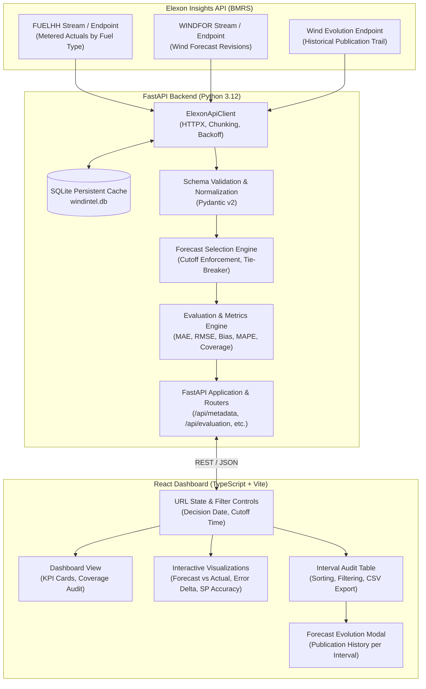

# WindIntel — System Architecture & Design

## 1. System Overview

WindIntel is a full-stack, decoupled intelligence platform for evaluating UK wind power generation forecasts against real metered outturn data from Elexon BMRS. It empowers day-ahead electricity trading and procurement teams to quantify forecast uncertainty, detect systematic model biases, and inspect historical publication evolutions.



---

## 2. Backend Architecture

### 2.1 Technology Stack & Rationale
- **Python 3.12:** Clean modern async runtime.
- **FastAPI:** High performance, asynchronous endpoints with automated OpenAPI documentation and Pydantic validation.
- **Pydantic v2:** Rigorous serialization, parsing, and datetime coercion.
- **HTTPX:** Async HTTP client supporting connection pooling, timeout configurations, and bounded exponential backoff retries.
- **SQLite:** Lightweight, serverless embedded database for durable caching of immutable historical BMRS data. Avoids external infrastructure overhead (e.g., Redis or Postgres) while surviving service restarts.

### 2.2 Directory Layout
```
backend/
├── app/
│   ├── __init__.py
│   ├── main.py                     # FastAPI app factory, CORS, exception handlers
│   ├── api/
│   │   ├── __init__.py
│   │   └── routes.py               # REST API endpoints
│   ├── core/
│   │   ├── __init__.py
│   │   ├── config.py               # Settings via pydantic-settings (.env support)
│   │   └── logging.py              # Structured logging configuration
│   ├── clients/
│   │   ├── __init__.py
│   │   └── elexon.py               # Robust HTTP client with 7-day chunking & retries
│   ├── db/
│   │   ├── __init__.py
│   │   └── cache.py                # SQLite query & response cache repository
│   ├── schemas/
│   │   ├── __init__.py
│   │   ├── actuals.py              # Ingested & normalized actuals models
│   │   ├── forecasts.py            # Forecast revisions & selection models
│   │   ├── evaluation.py           # Evaluation response schemas, KPI models
│   │   └── metadata.py             # System configuration & health metadata
│   └── services/
│       ├── __init__.py
│       ├── forecast_selection.py   # Pure, isolated selection algorithm
│       ├── evaluation.py           # Metric computations & coverage analysis
│       └── export.py               # Standardized RFC 4180 CSV generator
├── tests/
│   ├── conftest.py                 # Fixtures, synthetic datasets, mock clients
│   ├── test_forecast_selection.py  # Unit tests for cutoffs, duplicates, tie-breaking
│   ├── test_evaluation_metrics.py  # Mathematical tests for MAE, RMSE, Bias, MAPE
│   └── test_api_routes.py          # Integration tests for FastAPI endpoints
├── Dockerfile                      # Production container spec
└── requirements.txt                # Pinned dependencies
```

### 2.3 Layered Separation of Concerns
1. **API Layer (`api/routes.py`):** Accepts query parameters, enforces input validation via FastAPI dependencies, invokes application services, and returns strongly-typed Pydantic schemas. Catches application-level exceptions and formats predictable HTTP errors.
2. **Domain Service Layer (`services/`):**
   - `forecast_selection.py`: Completely pure Python function with zero I/O dependencies. Takes a list of forecast records and a cutoff timestamp, filters out post-cutoff records, and deterministically chooses the latest publication for each delivery interval.
   - `evaluation.py`: Aligns selected forecasts against metered actuals, calculates error values, computes summary statistics (MAE, RMSE, Bias, MAPE), and computes the full coverage accounting matrix.
3. **Infrastructure / Client Layer (`clients/elexon.py`, `db/cache.py`):**
   - Implements bounded chunking (at most 7 days per call).
   - Manages SQLite persistence to ensure historical data is retrieved once and cached indefinitely.

---

## 3. Frontend Architecture

### 3.1 Technology Stack & Rationale
- **React 19 & TypeScript:** Strict type safety matching backend Pydantic models.
- **Vite:** Rapid HMR, optimized production tree-shaking, and lightweight build output.
- **Vanilla Modern CSS / Design System:** Clean, dark-mode, dense financial/operational dashboard styling. Charcoal theme (`#0b0f17`, `#111827`, `#1e293b`), crisp typography, high-contrast badges, and zero unnecessary decorative bloat.
- **Recharts:** Responsive SVG charting with custom tooltip formatters, reference lines, and dual-series rendering.
- **Lucide React:** Crisp operational iconography.

### 3.2 Component Architecture
```
frontend/
├── src/
│   ├── api/
│   │   ├── client.ts           # Typed Fetch API wrapper for WindIntel backend
│   │   └── types.ts            # TypeScript interfaces synchronized with Pydantic
│   ├── components/
│   │   ├── Header.tsx          # Status indicators, cutoff info, data source badge
│   │   ├── FilterBar.tsx       # Date picker, cutoff selector, manual refresh
│   │   ├── SummaryCards.tsx    # MAE, RMSE, Bias, MAPE KPI cards with tooltips
│   │   ├── CoverageAudit.tsx   # Expected vs matched intervals, missing reasons
│   │   ├── ForecastChart.tsx   # Forecast vs Actual time-series chart
│   │   ├── ErrorChart.tsx      # Residual error bar/line chart with zero reference line
│   │   ├── SettlementPeriodChart.tsx # Diurnal accuracy by settlement period
│   │   ├── IntervalTable.tsx   # Sortable/filterable table with CSV export
│   │   ├── EvolutionModal.tsx  # Forecast publication revision history modal
│   │   ├── LoadingState.tsx    # Skeleton placeholders
│   │   └── ErrorState.tsx      # Diagnostic alert card with retry triggers
│   ├── styles/
│   │   └── index.css           # Modern design tokens, utility classes, typography
│   ├── App.tsx                 # Root layout, URL search param synchronization
│   └── main.tsx                # React DOM mount point
├── tests/
│   ├── Dashboard.test.tsx      # Component rendering & interaction tests
│   └── evaluation.test.ts      # Client-side formatting & transformation tests
├── Dockerfile                  # Multi-stage production Nginx container
├── package.json
└── vite.config.ts
```

---

## 4. Key Design Decisions & Operational Rationale

1. **Why Pure Forecast Selection?**
   Forecasting algorithms in production frequently suffer from data leakage (using forecasts published after decision time, or filtering based on observed actuals). By implementing forecast selection as a pure function isolated from actuals, we mathematically guarantee that future information cannot leak into historical purchasing evaluations.

2. **Why SQLite Persistent Cache?**
   January 2026 Elexon data is historical and immutable. Querying Elexon for identical ranges repeatedly introduces latency, risks rate limiting, and wastes bandwidth. A simple SQLite database provides sub-millisecond local reads, requires zero external setup, and preserves retrieved data across container restarts via volume mounts.

3. **Restrained, High-Density Dark Theme:**
   Energy market schedulers and traders monitor multiple screens simultaneously for hours. High-contrast, dark-mode designs with subtle borders and compact typography maximize information density while minimizing eye fatigue.
